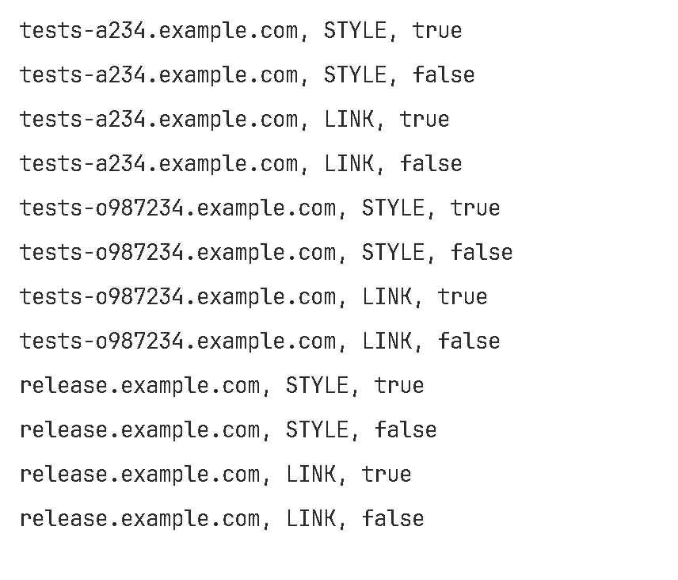

Jaisocx &#8482; &#169;


# Combiner

  >  💡  every combination of several datasets, in one-level loop


  🍮  **️Library**   `com.jaisocx.tools.combiner` | 🏷 **️ver.**: `3.2`  

  💶  **Earn**      Raise QA coverage easier, saving up on writing multilevel combining tasks.

  🗓  **Since**     AD 2024  🌼  Summer  | `AD 2024 Oct 29`

  🗓  **Date**      AD 2026  🌾  Autumn  | `AD 2026 Oct 31 01:40.500 GMT_24h`

  📐  **Size**      📝  JaisocxCombinerCls.java 3 KB  |  📦  jar 12 KB |  🗂  Dir 5 MB

  ⚡   **Keywords**  `[ "Java", "Test", "Unit Tests", "Combiner", "Combinations" ]`

  📝  **Java**     `src/main/java/com/jaisocx/tools/combiner/JaisocxCombinerCls.java`


## Features

- Secure: one level loop. Coding work of multilevel iterations, also, done time efficient.

- Produces every combination of several datasets.

- Any number of methods' args.

- Support for any simple data types in arrays or enums.


  📒  **JUnitTest example**  [readme/README_combiner_junittests.md](./readme/README_combiner_junittests.md)


## The aim of the setup

  >  💡  being able to solve a multilevel QA task, then the QA task for the 99% coverage will be in the sprint.


  
  For example, You have 3 datasets, and wish the combinations 
  of every value of each dataset of these 3,
  with every value in all 2 other datasets.
  

```Java
  String[] domainsNames = new String[] {
    "tests-a234.example.com",
    "tests-o987234.example.com",
    "release.example.com"
  };

  enum LoadingHtmlElems {
    STYLE,
    LINK;
  }

  Boolean[] booleanValues = new Boolean[] {
    true,
    false
  };

```


---





  
  The Combiner produces the entire set of unique combinations
  of data sets entries.
  


### 1. convert arrays to ArrayLists

```Java
  List<String> locDomainsNames = Arrays.asList( domainsNames );
  List<LoadingHtmlElems> locLoadingHtmlElems = Arrays.asList( LoadingHtmlElems.values() );
  List<Boolean> locBooleanValues = Arrays.asList( booleanValues );
```


### 2. combine

```Java
  List<List<Object>> combinations = JaisocxCombiner.combine (
    locDomainsNames,
    locLoadingHtmlElems,
    locBooleanValues
  );
```


### 3. see combinations in console

```Java
  //  💡  print all combinations less dangerous in a one-level loop
  JaisocxCombiner.printCombinations( combinations );
```


#### how this method works


`com.jaisocx.tools.combiner.JaisocxCombinerCls`


```Java
  // src/main/java/com/jaisocx/tools/combiner/JaisocxCombinerCls.java

  /**
  * terminal prints every combination in one line
  */
  public void printCombinations (List<List<Object>> combinations) {
    combinations.forEach(combinationItem -> this.printCombinationsItem( combinationItem ));
  }


  /**
  * terminal prints every field of a combinations' item
  */
  public void printCombinationsItem (List<Object> combinationItem) {

    // terminal prints every field of a combinations' item
    combinationItem.forEach(object -> System.out.print( object.toString() + " " ));

    // new line
    System.out.println();
  }
  
```

---


Have a nice day, Jaisocx Inc. Software Architect Illia Polianskyi


